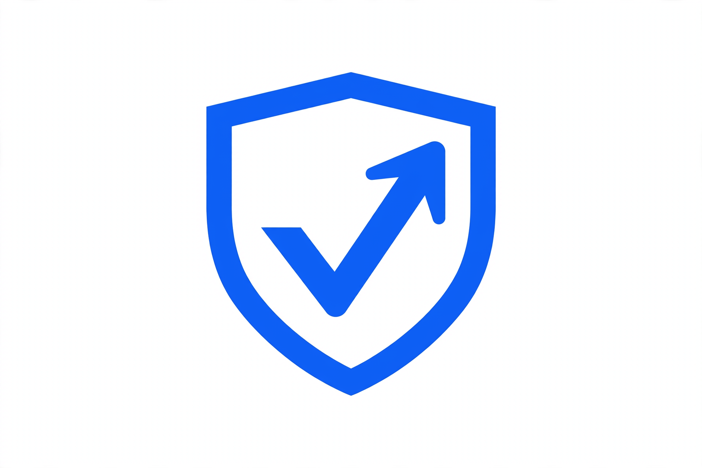
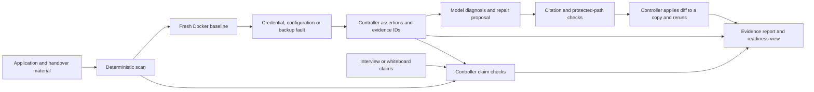

<p align="center">
  
</p>

<h1 align="center">HandoffProof</h1>

<p align="center"><strong>Rehearse the day your developer leaves.</strong></p>

<p align="center">
  <a href="https://github.com/gowtham472/handoffproof/actions/workflows/handover.yml"></a>
  
  
  
</p>

HandoffProof helps a team rehearse what happens when its developer leaves. It runs
an application in an isolated Docker environment, introduces handover faults, and
records which workflows still work. It also checks information from exit interviews
and experimental whiteboard inputs against code, configuration, and recorded evidence.

> **The Go controller determines outcomes. Models explain evidence and propose changes.**
> A model cannot award a pass, change protected acceptance tests, or replace controller evidence.

Built independently by Gowtham in Chennai during the Meta Global AI Developer Hackathon,
October 26 to November 4, 2026.

**Demo video:** [Watch HandoffProof on YouTube](https://youtu.be/LIAsrzvvelM).

## Contents

- [Why HandoffProof](#why-handoffproof)
- [Features](#features)
- [How it works](#how-it-works)
- [Model roles and routing](#model-roles-and-routing)
- [Quick start](#quick-start)
- [Control Room](#control-room)
- [Test your own application](#test-your-own-application)
- [Profile auto-drafting](#profile-auto-drafting)
- [Exit interviews](#exit-interviews)
- [Private mode](#private-mode)
- [Whiteboard claims](#whiteboard-claims)
- [Slack and GitHub](#slack-and-github)
- [CLI reference](#cli-reference)
- [Results and limitations](#results-and-limitations)
- [Security](#security)
- [Development and quality checks](#development-and-quality-checks)
- [Project layout](#project-layout)
- [Documentation](#documentation)
- [Built during the event](#built-during-the-event)

## Why HandoffProof

A working homepage does not tell a team whether it can operate an application without
its original developer. Mail credentials may belong to one person, a required setting
may be undocumented, and a database backup may leave uploaded files behind.

HandoffProof turns these concerns into a rehearsal. It separates measured failures,
measured successes, inferred risks, and dependencies that have not been tested. The
report keeps these distinctions instead of presenting every model suggestion as fact.

## Features

| Capability | What it provides |
| --- | --- |
| Static scan | Deterministic inspection of services, environment names, jobs, upload paths, documentation gaps, and backup coverage |
| Fault rehearsals | A fresh baseline, withdrawn test credential, missing configuration, and incomplete-backup checks in Docker sandboxes |
| Diagnosis and citation checking | Model explanations linked to controller evidence and source references, followed by deterministic citation checks |
| Repair and rerun | Reviewable repair diffs, protected-path checks, and controller-run acceptance checks in a sandbox copy |
| Bring Your Own App | Local-folder or GitHub import of Docker Compose applications using a declarative workflow profile |
| Profile auto-drafting | A model proposes a profile; validation, secret screening, and an unedited sandbox baseline gate its availability in the wizard |
| Exit interviews | Audio transcription or transcript input, structured claim extraction, and controller checks against scan and drill evidence |
| Private mode | Local model routing, or hybrid routing that keeps the core source-reading phases local |
| Whiteboard claims, experimental | Screen and note segmentation, screen pixelation before vision analysis, and claim checking |
| Evidence and sharing | HTML reports, evidence pagination, browser print-to-PDF, expiring read-only links, and Slack summaries |
| Readiness tools | Deterministic Handover Score, score history, and a what-if view for dependency changes |
| Model evaluation | Recorded comparisons of models, citations, tokens, latency, and repair outcomes, including misses and runs not performed |

The presence of a feature does not imply general accuracy or successful automatic
recovery. See [Results and limitations](#results-and-limitations).

## How it works



The bundled application exercises registration, booking, confirmation email, and
uploaded-document recovery. The registered drill names are:

1. `fresh_deployment_baseline`
2. `withdrawn_test_token`
3. `missing_configuration`
4. `incomplete_backup`

Models read application material as untrusted data. Observed findings need controller
evidence IDs. Inferred risks and untested dependencies stay labelled as such. A proposed
repair is not evidence of recovery; the controller must run the relevant checks again.

## Model roles and routing

The default configuration in [.env.example](.env.example) uses Muse Spark 1.3 for the
core agent. Its six phases are `intake_summary`, `dependency_map`, `diagnosis`,
`repair_proposal`, `assessment`, and `verification`. The prompt also defines a
`drill_plan` schema, but the controller selects drill order; that model phase is not invoked.

| Model or route | Role in this project |
| --- | --- |
| Muse Spark 1.3 | Default core agent, interview claim extraction, and the configured vision model for the experimental whiteboard example |
| Muse Wonder | Optional repair-phase route and the default profile-drafting model |
| Muse Voice Transcribe | Cloud transcription for exit-interview audio |
| Muse Glimmer | Configured local model for private mode through an OpenAI-compatible endpoint |
| SAM 3.1 | Finds screen and sticky-note regions in the experimental whiteboard pipeline |
| Muse Image | Generates the labelled synthetic whiteboard fixture when explicitly requested |
| Muse Spark Open | Optional benchmark profile; its recorded status is listed in the results |

The default core route uses Meta Responses. Per-phase settings can instead select an
OpenAI-compatible chat endpoint, and private mode changes the routing further. Audio
and image operations use their dedicated clients. It is therefore not accurate to
say that every product call goes through the same endpoint or the same model.

Core phases request JSON matching a declared schema. Invalid responses are retried
within bounded schema and tool budgets, then rejected if they still do not validate.
Phase records include the model, provider, token usage, latency, and private-mode setting.

For example, this optional setting routes core repair proposals to Wonder:

```dotenv
HANDOFF_MODEL_REPAIR=muse-wonder-1.0
```

Each core phase also accepts `HANDOFF_PROVIDER_<SHORT>`, `HANDOFF_BASE_URL_<SHORT>`,
and `HANDOFF_KEY_ENV_<SHORT>`. The short names and supported providers are documented
in [.env.example](.env.example). Unknown providers and unresolved keys fail closed.
Interview extraction and profile drafting have their own routing rules; a repair
phase override does not change every model operation.

When the core agent cannot be configured, scan and drill commands label its phases
as skipped instead of inventing model output. Commands that require a model, such as
profile drafting, report configuration errors. Deterministic scans and controller
checks do not require model-generated verdicts.

## Quick start

Run from the repository root. Requirements depend on the workflow:

- Go 1.27.3 or newer, matching [go.mod](go.mod).
- Docker Engine or Docker Desktop with Compose v2 for baselines and fault rehearsals.
- Bash and the usual Unix utilities for the repository scripts. On Windows, use Git Bash.
- Node.js 20 or newer and npm for the independent Playwright acceptance checks.
- A Meta Model API key for cloud model features, or a configured local runtime for local mode.

```bash
git clone https://github.com/gowtham472/handoffproof.git
cd handoffproof
cp .env.example .env
```

Edit `.env` to configure the model features you want. Keep real credentials out of Git.
For the default cloud agent, set `META_API_KEY` and retain or choose `META_MODEL_ID`.
The console itself can start without a model key:

```bash
go run ./cmd/handoffproof serve
```

Open the local token URL printed at startup. The default address is
`http://127.0.0.1:8787`. If `HANDOFF_CONSOLE_TOKEN` is missing or shorter than 16
characters, the server generates a random token. Treat the printed URL as a credential.
Configuration loads from `.env` at startup, so restart after changes.

For an initial scan:

```bash
go run ./cmd/handoffproof scan --repo demo-app
```

Without configured model credentials, this prints the deterministic scan and explains
why the agent was skipped. With a configured agent, it also runs the intake and
dependency-map phases.

To run a controller baseline without model diagnosis, start Docker and run:

```bash
go run ./cmd/handoffproof drill --drill fresh_deployment_baseline --diagnose=false
```

Use the Control Room for the interactive walkthrough. For shared deployment, HTTPS,
integration credentials, and storage, see [Deployment](docs/DEPLOYMENT.md).

## Control Room

The Go server includes a browser console styled with IBM Carbon and Qiskit conventions.

| Page | Purpose |
| --- | --- |
| Get started | A six-step onboarding checklist with live completion state |
| Applications | Import a Compose application, edit its profile, load a previously accepted draft, and run application rehearsals |
| Readiness | Bundled-demo scan results, planned faults, score, trends, and what-if analysis |
| Rehearse | Run bundled-demo drills and inspect assertions, logs, and outcomes |
| Evidence | Filter records, view interview claims, open the full report, print, share, or post to Slack |
| Insights | Diagnosis, confidence, source citations, verification, and assessment |
| Settings | Integration connection status, notification settings, and report preferences |
| About HOP | Project purpose, architecture, model roles, and operating principles |

Interview records are produced by the CLI and displayed in Evidence. The profile-load
button retrieves an existing candidate; it does not start a model drafting job.
Imported-application runs share the Evidence store, while several Readiness and Rehearse
views still describe the bundled demo.

Read-only share links open without an operator login and expire after 24 hours. Their
hashes persist across server restarts. PDF export uses the browser print layout.

## Test your own application

Applications must run with Docker Compose. Import a local server-side folder or a
repository selected through the GitHub integration, then provide `handoffproof.json`.

The profile describes services, an in-container HTTP probe runtime, environment names,
credential dependencies, workflows, and optional backup/restore steps. Supported workflow
steps include `http`, `sql_count`, `log_contains`, and `file_exists`.

1. Import the source and review the profile.
2. Supply sandbox-only environment values separately from the profile.
3. Validate the profile and Compose safety rules.
4. Run a baseline before introducing faults.
5. Review records carrying the application ID, profile version, source hash, and fault target.

Environment values entered through the wizard are encrypted on the server and are not
returned to the browser. Profiles contain names and structure, never secret values.
See the [application guide](docs/guide/applications.md) for the profile contract and limits.

## Profile auto-drafting

The CLI can ask a model to propose a profile from an application's source:

```bash
go run ./cmd/handoffproof draft --app-dir /path/to/application --env-file /path/to/test.env
```

The default model is Muse Wonder, configurable through `HANDOFF_MODEL_DRAFT`. In local
or hybrid private mode, drafting uses the local route because it reads source.

The proposal must decode strictly, pass secret screening and profile/Compose validation,
and complete an unedited sandbox baseline before it can be loaded in the wizard. The
model receives validator feedback for up to three attempts. Review an accepted candidate
before importing; it is still a proposal, not a complete handover guarantee.

The Applications wizard's **Load** control retrieves the latest eligible candidate for
the selected application. `--no-baseline` is a diagnostic option; such a draft is not
eligible for display. Current measured draft limitations are in
[Results](docs/RESULTS.md#profile-auto-drafter-f6).

## Exit interviews

Turn an exit interview into claims about credentials, configuration, backups, and
operating procedures. Use audio or a transcript:

```bash
go run ./cmd/handoffproof interview --audio /path/to/handover.wav --app-dir demo-app
go run ./cmd/handoffproof interview --transcript eval/fixtures/interview-transcript.json --app-dir demo-app
```

Audio uses Muse Voice Transcribe. Claim extraction uses the configured default model,
independently of the repair-phase override. The controller filters injected instructions
and checks supported claims against the static scan and existing drill evidence.
Unsupported or untested claims remain unverifiable and may need a written runbook.

Records store redacted transcripts and claims under `evidence/`. The console shows the
latest interview in Evidence. To include a specific record in a generated report, use
`report --interview /path/to/interview.json` together with the required `--evidence` input.
Local mode refuses cloud transcription; supply a locally produced transcript instead.

## Private mode

Set `HANDOFF_PRIVATE_MODE` to `off`, `local`, or `hybrid`.

| Mode | Behaviour |
| --- | --- |
| `off` | Uses the configured default and per-phase routes |
| `local` | Sends the core model phases to a loopback endpoint and blocks non-loopback model requests |
| `hybrid` | Keeps core intake, dependency mapping, and diagnosis local; cloud-routed core phases lose source-reading tools |

Example configuration for an already running local compatible endpoint:

```dotenv
HANDOFF_PRIVATE_MODE=local
HANDOFF_GLIMMER_BASE_URL=http://127.0.0.1:11434/v1
HANDOFF_GLIMMER_MODEL=muse-glimmer
```

The local runtime must actually serve the configured model and support the required
chat/tool behaviour. Local mode does not need a Meta key for its core phases. It rejects
cloud transcription and the cloud whiteboard pipeline. A bad mode or non-loopback local
endpoint is an error, not a silent fallback to the cloud.

Hybrid mode still uses cloud services. Interview extraction uses the process default
in hybrid mode; it is not one of the six per-phase routes. Slack and GitHub connections
are also separate cloud integrations. Private mode is not a claim that the entire
console or host is disconnected from the network.

## Whiteboard claims

**Experimental.** This CLI pipeline reads handover notes from PNG/JPEG images:

```bash
go run ./cmd/handoffproof whiteboard --image /path/to/whiteboard.png --app-dir demo-app
```

SAM 3.1 receives the image to locate screens and sticky notes. Detected screens are
pixelated before the prepared image and note crops reach the vision model. That model
proposes claims, which the controller checks using the same claim-verification rules
as exit interviews. This is not a promise that raw images never reach a cloud service.

`whiteboard --generate` creates the labelled synthetic fixture with Muse Image.
`--reverify /path/to/record.json` recomputes controller checks on recorded claims without
new model calls. Local mode blocks the cloud image pipeline. The evaluation covers a
labelled synthetic fixture, not general image accuracy; see
[Whiteboard results](docs/RESULTS.md#whiteboard-claims-f7-experimental).

## Slack and GitHub

| Integration | What it provides | Setup |
| --- | --- | --- |
| Slack | OAuth connection, manual summaries, opt-in rehearsal notifications, failure-only filtering, and delivery status | [Slack guide](docs/guide/connect-slack.md) |
| GitHub | GitHub App installation access or existing OAuth with PKCE, repository/branch selection, and application import | [GitHub guide](docs/guide/connect-github.md) |

Slack messages contain structured counts, integrity information, and controller evidence
IDs. They exclude credentials, share links, raw assertions, logs, and model text.
Automatic notifications require saved opt-in settings. There is no durable retry queue.

GitHub App mode uses repository Contents/Metadata read access. Legacy OAuth uses the
broader `repo` scope. Integration credentials stay encrypted outside the repository.
Slack's OAuth flow needs a public HTTPS address; GitHub OAuth also supports a loopback
callback. Follow the guides for the selected authentication mode.

The remediation PR command is separate from read-only repository access. It is a dry run
by default; `--execute` prepares a branch and commit in a temporary clone. It does not
push or open a PR automatically.

## CLI reference

Examples below use `go run ./cmd/handoffproof`; after building, use `handoffproof` instead.

| Command | Purpose and useful flags |
| --- | --- |
| `serve` | Start the console; `--addr 127.0.0.1:8787` |
| `scan` | Inspect an application; `--repo demo-app`; optionally runs intake/mapping |
| `drill` | Run a registered drill; `--drill NAME`, `--params key=value`, `--diagnose=false`; `--full` continues through model repair proposal, controller rerun, and assessment |
| `repair` | Apply an existing unified diff to a sandbox copy and rerun acceptance; `--diff FILE`, with `app/`-prefixed paths |
| `report` | Generate HTML; `--evidence FILE` required, optional `--diagnosis FILE`, `--interview FILE`, `--out FILE` |
| `verify` | Check diagnosis citations and evidence references; `--diagnosis FILE`, optional `--model=false` |
| `interview` | Transcribe/load and check claims; `--audio FILE` or `--transcript FILE`, optional `--app-dir DIR` |
| `draft` | Propose and baseline a profile; `--app-dir DIR`, optional `--env-file FILE`, `--reps N`; `--render` refreshes the recorded-results section |
| `whiteboard` | Experimental image claims; `--image FILE`, `--generate`, `--reverify FILE`, or `--render` |
| `pr` | Review a remediation plan; `--diff FILE`, optional `--execute` for local clone preparation only |
| `eval` | Model/fixture evaluation; `--models a,b`, `--reps N`, or `--render-only` for existing records |
| `score` | Calculate readiness components and append the score history |

Some commands write records under `evidence/`; evaluation/render commands may update
`docs/RESULTS.md`. Keep generated results distinct from source and never commit secrets.

## Results and limitations

[docs/RESULTS.md](docs/RESULTS.md) contains the recorded evaluations, model comparisons,
misses, and runs not performed. It identifies the evaluated code revision and the
underlying artifacts. These are fixture-specific records, not a production reliability
or general model-accuracy claim.

- **Repair:** a proposed or applied diff does not establish recovery. Check the new
  controller evidence; benchmark first-try repair limitations are reported in Results.
- **Auto-drafting:** manual profile authoring remains available when a draft is rejected. The final
  measured miniapp drafts did not reach an accepted baseline; other runs are explicitly
  labelled when not performed with the final code.
- **BYOA:** Compose-only, with no HTTP response-value capture between steps. Backup
  testing compares workflow behaviour after restoration with a skipped-restore run;
  it does not provide arbitrary-store file-hash verification.
- **Local models:** routing/egress checks and model-quality evaluation are different
  questions. The results document which local/Open profiles were not run.
- **Whiteboards:** experimental, with synthetic-fixture evaluation only. Segmentation
  can miss sensitive regions, so do not treat pixelation as universal redaction.
- **Interview claims:** verification depends on available scan/drill evidence and
  keyword-based claim polarity. Ambiguous wording, including double negatives, can
  be misread; unsupported process claims need human documentation.
- **Sharing and integrations:** share links expire after 24 hours; PDF is browser
  print-to-PDF; Slack uses an incoming webhook rather than a full interactive bot.

## Security

The controller checks the protected-file manifest around drills and reruns. Repair diffs
are restricted to the sandbox application copy. Application code, documentation, model
output, transcripts, and image-derived claims are treated as untrusted input.

Sandboxes use internal Docker networks with no published ports. Console writes require
operator authentication and CSRF protection. Source imports and agent tools screen
secret-shaped paths; records and reports redact secret-like strings. No API keys belong
in profiles, prompts, reports, or Git.

Read [Security](docs/SECURITY.md) for the actual trust boundaries, dated review history,
and residual risks. That document is not a certification or a guarantee of complete
security. The host operator and Docker daemon remain trusted.

## Development and quality checks

```bash
bash scripts/check.sh
```

This runs formatting, vet, Go tests, skill validation, and protected-file verification.
Tests include a Docker-based Python fixture, so a running Docker daemon alone does not
guarantee that image builds and sandbox startup will complete. Investigate any timeout;
do not describe an incomplete gate as passing.

On Windows, Application Control may block executables produced by `go run`.
If the operating system blocks execution, use an approved development environment;
that policy block is separate from a Go compilation or application error.

The [handover workflow](.github/workflows/handover.yml) also defines independent
Playwright acceptance checks and a controller baseline. CI definitions show intended
checks; their presence is not evidence that a particular run succeeded.

The protected paths are listed by [scripts/manifest.sh](scripts/manifest.sh) and frozen
in [.manifest.sha256](.manifest.sha256). Do not refresh the manifest to hide a failure.

## Project layout

```text
cmd/handoffproof/     CLI, console, application registry, Slack/GitHub integrations
internal/controller/ Deterministic orchestration and claim checks
internal/drills/     Baseline and fault definitions
internal/evidence/   Evidence records and IDs
internal/agent/      Model clients, phase routing, tool loop, validation, redaction
internal/scan/       Deterministic application inspection
internal/byoa/       Profile contract and Compose sandbox runner
internal/draft/      Profile proposal screening and validation helpers
internal/privatemode/ Local/hybrid routing and model-request egress guard
internal/whiteboard/ Image preparation and pixelation
internal/report/     Single-file HTML evidence report
internal/score/      Deterministic readiness scoring
acceptance/          Independent Playwright workflow checks
demo-app/            Bundled Node.js/PostgreSQL application
mocks/mail-sink/     Deterministic local mail provider
eval/               Ground truth and evaluation fixtures
demo/               Repository demo video
docs/               Guides, decisions, security, and recorded results
```

## Documentation

| Document | Contents |
| --- | --- |
| [Application guide](docs/guide/applications.md) | Profile fields, workflow steps, import flow, backup checks, and BYOA limits |
| [Slack guide](docs/guide/connect-slack.md) | OAuth setup, manual/automatic posting, and troubleshooting |
| [GitHub guide](docs/guide/connect-github.md) | GitHub App and OAuth setup, repository access, and import |
| [Deployment](docs/DEPLOYMENT.md) | Host setup, HTTPS, encrypted stores, operation, and troubleshooting |
| [Security](docs/SECURITY.md) | Trust boundaries, review history, and residual risks |
| [Results](docs/RESULTS.md) | Recorded comparisons, failure reasons, and unrun evaluations |
| [Decisions](docs/DECISIONS.md) | Architecture decisions and sources |
| [Plan](docs/PLAN.md) | Implementation plan and milestones |
| [Demo script](docs/DEMO_SCRIPT.md) | Repository demo walkthrough |

The results document records the revision evaluated, which may differ from the commit
containing the generated results file.

## Built during the event

Built during the Meta Global AI Developer Hackathon, October 26 to November 4, 2026.
**Contributor:** Gowtham ([gowtham472](https://github.com/gowtham472)), Chennai, solo.
Muse Code was used as a coding agent, with AI assistants supporting planning and
implementation. Build-time assistants are separate from the runtime model routes above.

**Repository demo:** [Watch the video](demo/handoffproof-demo.mp4).
Newer local production cuts are separate working artifacts. Their ignored
source folders are not required to run HandoffProof and are not linked as public guides.

Illustrations adapted from [Storyset](https://storyset.com). Report and console visuals
follow IBM Carbon conventions. Follow the credits accompanying each distributed video
for its music and sound effects.
