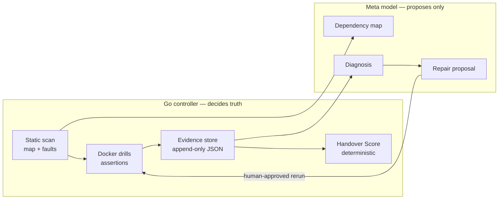
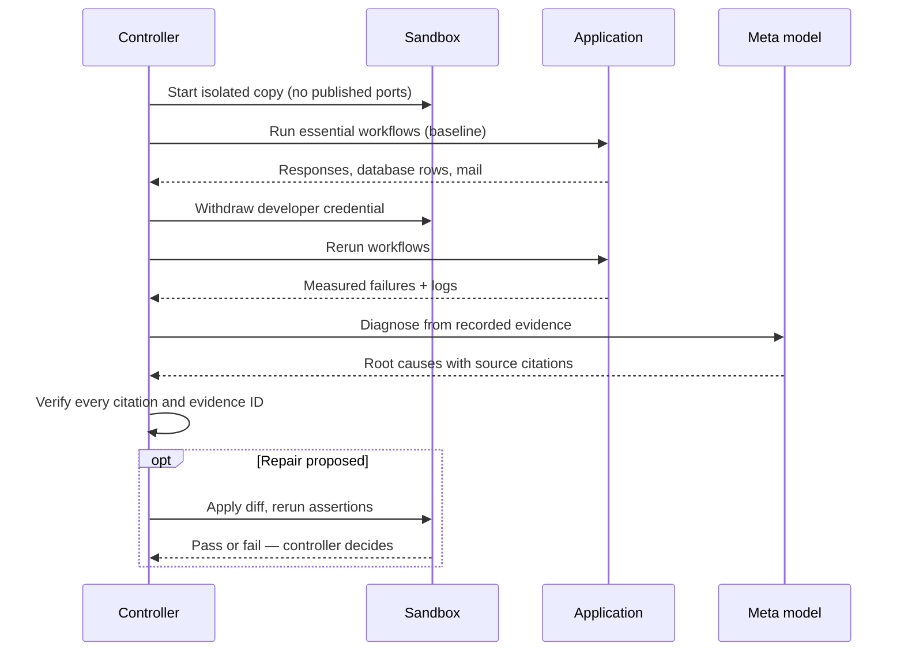
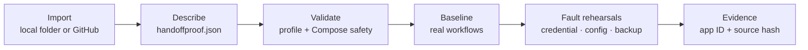

<p align="center">
  
</p>

<h1 align="center">HandoffProof</h1>

<p align="center"><strong>Rehearse the day your developer leaves.</strong></p>

<p align="center">
  <a href="https://github.com/gowtham472/handoffproof/actions/workflows/handover.yml"></a>
  
  
  
</p>

HandoffProof rehearses a developer exit before it happens. It starts an application in an isolated
Docker sandbox, runs its essential workflows, withdraws the departing developer's credentials,
removes configuration, attempts backup recovery, and records exactly what broke — with logs,
source references, and rerun results.

One rule governs the whole system:

> **A deterministic Go controller decides pass or fail. The AI model only proposes, explains, and repairs.**
> The model can never award a pass, edit acceptance tests, or write evidence.

Built during the Meta Global AI Developer Hackathon (26 Oct – 4 Nov 2026).

---

## Contents

- [Why HandoffProof](#why-handoffproof)
- [How it works](#how-it-works)
- [How the Meta model is used](#how-the-meta-model-is-used)
- [The rehearsal](#the-rehearsal)
- [Features](#features)
- [Control Room](#control-room)
- [Quick start](#quick-start)
- [Test your own application](#test-your-own-application)
- [HOP Connect: Slack and GitHub](#hop-connect-slack-and-github)
- [CLI reference](#cli-reference)
- [Security](#security)
- [Project layout](#project-layout)
- [Development and quality gate](#development-and-quality-gate)
- [Documentation](#documentation)
- [Status and limitations](#status-and-limitations)

## Why HandoffProof

When the only developer leaves, teams discover the truth too late: credentials lived in one
person's inbox, configuration was never written down, and the backup was never tested. HandoffProof
turns that discovery into a scheduled rehearsal with measured evidence, so the gaps are found —
and fixed — while the developer is still there to answer questions.

## How it works



The controller owns verdicts, evidence, scoring, and every protected path. The model reads code
and recorded evidence, then proposes a dependency map, a diagnosis with `file:line` citations, and
a repair diff. A repair is only believed after the controller reruns the drill and the assertions
pass.

## How the Meta model is used

Every runtime model call goes through the Meta Model API Responses endpoint
(`POST <META_API_BASE_URL>/responses`, default base `https://api.meta.ai/v1`).
The model ID is read from `META_MODEL_ID` — this project's configuration uses
`muse-spark-1.3` — and there is no silent fallback: a missing key or model ID
fails closed and the agent phases are skipped and labelled as skipped.

Each call is a phase with structured output: the request carries a JSON
schema for that phase, and a response that does not validate is retried
separately from tool turns, then rejected. The controller verifies citations
and evidence IDs deterministically afterwards; the model never sets a verdict.

| Phase | Called from | What the model returns |
| --- | --- | --- |
| `intake_summary` | `handoffproof scan` | A short intake summary of the app under test |
| `dependency_map` | `handoffproof scan` | Dependencies with kind, ownership, and proposed checks |
| `diagnosis` | `handoffproof drill` | Root causes citing evidence IDs and `file:line` sources |
| `repair_proposal` | `handoffproof repair` | A unified diff the controller may apply and rerun |
| `assessment` | `handoffproof drill` | A narrative assessment of the recorded evidence |
| `verification` | `handoffproof verify` | Adversarial citation/evidence verdicts per finding |

A `drill_plan` schema is defined in the agent prompt, but the current code
does not invoke that phase; drill order and verdicts are the controller's.

**Built with** Muse Code as the coding agent, plus AI assistants for
planning. All runtime model calls go through the Meta Model API described
above; no other model runs inside the product.

**Team** Solo — Gowtham ([gowtham472](https://github.com/gowtham472)).

**Demo video:** [demo/handoffproof-demo.mp4](demo/handoffproof-demo.mp4) (2:30 animated walkthrough with recreated UI based on recorded demo evidence; script in [docs/DEMO_SCRIPT.md](docs/DEMO_SCRIPT.md), built with Remotion from `film/`). A revision using actual application footage is planned.

## The rehearsal



Drills run in a fixed order: `withdrawn_token`, then `missing_configuration`, and
`incomplete_backup` last, because backup recovery is only meaningful after the first two are understood.

## Features

| Capability | What it does |
| --- | --- |
| Static scan | Maps services, environment, credentials, data stores, and planned faults without starting the app |
| Docker drills | Runs baseline and fault rehearsals in an isolated sandbox and asserts real workflow outcomes |
| AI diagnosis | Explains failures from recorded evidence, with citations the controller verifies before display |
| Guardrailed repair | Turns a diagnosis into a reviewable diff; protected paths are refused and the drill is rerun |
| Evidence report | Produces a themed HTML report with integrity state, paginated evidence, print-to-PDF, and read-only share links |
| Handover Score | Computes a deterministic readiness score and keeps its history for the trend view |
| What-if simulator | Previews which workflows a dependency change would break, and which drill would confirm it |
| Adversarial verifier | Checks diagnosis citations deterministically, then asks the model to propose corrections |
| Benchmark | Scores map and diagnosis quality against ground truth, including a second fixture (author-written) application |
| HOP Connect | Connects Slack and GitHub so summaries and repositories flow into the rehearsal |
| Bring Your Own App | Onboards a Docker Compose application through a declarative profile - tested end to end on a bundled Python fixture and one external application — see below |

## Control Room

The Go binary serves the operator console. It binds to loopback, requires authentication, and is
styled with IBM Carbon and Qiskit conventions: IBM Plex, a fixed masthead and side navigation,
Carbon tiles, tables, and tags.

| Page | Purpose |
| --- | --- |
| Get started | Six-step onboarding checklist with a live done state for each step |
| Applications | Import and rehearse your own Docker Compose application |
| Readiness | Scan results, planned faults, and the deterministic Handover Score |
| Rehearse | Run drills and watch assertions, logs, and outcomes |
| Evidence | Browse recorded evidence, open the full report, share it, or post it to Slack |
| Insights | Diagnosis findings, confidence, citations, reasoning, and the final assessment |
| Settings | Slack and GitHub integrations and report preferences (operators manage, everyone can view status) |
| About HOP | What HandoffProof is, how verdicts work, and the topic index |

Sharing works the way people expect: **Copy link** mints a read-only link that opens without any
sign-in, cookie, or token typing; **Download PDF** uses the themed report's print layout; and
**Post to Slack** sends a counts-only summary — never tokens, links, webhook URLs, or model text.

## Quick start

Prerequisites: Go, Docker with Compose, and a Meta Model API key.

```bash
cp .env.example .env   # then fill in META_API_KEY and the console token
go run ./cmd/handoffproof serve
```

The server prints a token URL for `http://127.0.0.1:8787` — open it in a browser.
Configuration is read from `.env` at startup, so restart the server after editing it.
See [.env.example](.env.example) for every supported variable.

## Test your own application

**Applications** onboards a Docker Compose application you own — it is not limited to the bundled demo:



1. Import from a local folder on the server or from a connected GitHub repository.
2. Describe services, health checks, environment names, credentials, workflows, data stores, and
   backup in a declarative `handoffproof.json`. Secret values never belong in the profile.
3. Validate, run the baseline, then run credential, configuration, and backup rehearsals.
4. Review results in Evidence; every record carries the application ID, profile version, and source hash.

Wizard environment values are encrypted on the server and never returned to the browser.
Full guide: [Test your own application](docs/guide/applications.md).

## HOP Connect: Slack and GitHub

| Integration | What it provides | Guide |
| --- | --- | --- |
| Slack | Add to Slack (OAuth), post counts-only rehearsal summaries to a chosen channel, disconnect in Settings | [Connect Slack](docs/guide/connect-slack.md) |
| GitHub | Connect GitHub (OAuth + PKCE), load and save a repository and branch, import applications from it | [Connect GitHub](docs/guide/connect-github.md) |

Both integrations are operator-managed, store their secrets encrypted outside the repository, and
never expose a token or webhook to the browser. Slack requires an HTTPS public URL for the OAuth
redirect; GitHub also accepts a loopback callback for local use.

## CLI reference

| Command | Purpose |
| --- | --- |
| `handoffproof serve` | Start the Control Room console |
| `handoffproof scan` | Static scan: dependency map and planned faults |
| `handoffproof drill` | Run one rehearsal drill in the sandbox |
| `handoffproof report` | Generate the HTML evidence report |
| `handoffproof verify` | Adversarially verify a diagnosis and its citations |
| `handoffproof repair` | Propose a repair from a recorded diagnosis |
| `handoffproof pr` | Prepare a guardrailed remediation PR (dry-run by default) |
| `handoffproof eval` | Regenerate benchmark results in `docs/RESULTS.md` |
| `handoffproof score` | Compute the Handover Score and append it to the history |

## Security

HandoffProof is built to be attacked by its own inputs: untrusted application code runs only in a
sandbox with no published ports and an internal network, console writes require an operator
session and a CSRF header, secret-shaped paths are refused by meaning (not just by name), model
output is redacted fail-closed, and report integrity is measured from hashes rather than asserted.

The full threat model, remediation log, production operating rules, and accepted residual risks
are in [docs/SECURITY.md](docs/SECURITY.md). No software is "fully secure"; HandoffProof documents
**no known CRITICAL or HIGH findings under its stated threat model**.

## Project layout

```text
cmd/handoffproof/     CLI, Control Room server, Slack/GitHub integrations, web console
internal/controller/  Drill orchestration and deterministic verdicts (protected)
internal/drills/      Fault definitions and assertions (protected)
internal/evidence/    Append-only evidence records (protected)
internal/agent/       Meta Responses client, tool loop, citation verifier (protected)
internal/byoa/        Bring Your Own App profile schema and sandbox runner
internal/report/      Themed HTML report generation
internal/score/       Deterministic Handover Score
demo-app/             Bundled demonstration application
acceptance/           Independent Playwright acceptance suite (protected)
docs/                 Plan, decisions, security, results, and user guides
scripts/check.sh      The quality gate: gofmt, vet, tests, skills, protected-path manifest
```

Paths marked protected are hashed in `.manifest.sha256`; the quality gate fails if they change
without a deliberate manifest refresh.

## Development and quality gate

Run the gate before calling anything done:

```bash
bash scripts/check.sh   # gofmt, go vet, go test, skill checks, protected-path manifest
```

CI repeats the gate on every pull request and adds the independent acceptance suite plus one
controller baseline drill in a fresh sandbox (`.github/workflows/handover.yml`).

## Documentation

| Document | Contents |
| --- | --- |
| [docs/PLAN.md](docs/PLAN.md) | Build order, milestones, and feature log |
| [docs/DECISIONS.md](docs/DECISIONS.md) | Architecture and product decisions with rationale |
| [docs/SECURITY.md](docs/SECURITY.md) | Threat model, remediation log, operating rules, residual risks |
| [docs/RESULTS.md](docs/RESULTS.md) | Benchmark results regenerated by `handoffproof eval` |

Note: `docs/RESULTS.md` records the code commit that was evaluated, not the
commit that contains the results file.
| [docs/DEMO_SCRIPT.md](docs/DEMO_SCRIPT.md) | Narrated demonstration walkthrough |
| [docs/DEPLOYMENT.md](docs/DEPLOYMENT.md) | Production deployment, operations, and troubleshooting guide |
| [docs/guide/connect-slack.md](docs/guide/connect-slack.md) | Slack app setup, connection, posting, troubleshooting |
| [docs/guide/connect-github.md](docs/guide/connect-github.md) | GitHub OAuth setup, repository selection, import |
| [docs/guide/applications.md](docs/guide/applications.md) | Bring Your Own App profile reference and rehearsal flow |

## Status and limitations

Implemented and verified: the deterministic core, live Meta agent loop, all three drills, repair
rerun, Control Room, themed report with share links and PDF, Slack and GitHub integrations,
Bring Your Own App onboarding, security remediation, and the CI handover gate.

Known limitations, stated plainly:

- Bring Your Own App targets Docker Compose applications. It is tested end to end on a bundled
  Python fixture (in the test suite) and was run manually against one real external Node API;
  other Compose applications are expected to work through the same profile contract, but that
  broader claim is not yet measured. HTTP workflow steps cannot yet capture a value from one
  response to use in the next step.
- Slack posting uses an incoming webhook, so live cards, threads, and slash commands would need a
  future bot-token upgrade.
- GitHub tokens use the OAuth `repo` scope; direct PR creation from the UI is intentionally not
  automated — the CLI prepares a dry-run and leaves pushing to a human.
- Read-only share links expire after 24 hours; they now persist across restarts (only SHA-256
  hashes are stored, in `HANDOFF_SHARE_FILE` or the OS temp directory).
- PDF export is the browser's print-to-PDF of the themed report, not a server-generated binary.

Meta model roles (numbers come only from [docs/RESULTS.md](docs/RESULTS.md), generated from
`evidence/eval`; 3 runs per cell on author-written fixtures):

- **Muse Spark 1.3** runs all six agent phases by default and Exit Interview claim extraction;
  measured: 6/6 runs OK, all planted faults caught, 0 false alarms, 0/6 first-try repair applies.
- **Muse Wonder** handles repair proposals through per-phase routing (`HANDOFF_MODEL_REPAIR`);
  measured: 6/6 runs OK, same detection, 1.4–1.7x Spark's tokens per run, 0/4 first-try applies.
- **Muse Spark Open** is a benchmark profile via Together AI; not run (no `TOGETHER_API_KEY`).
- **Muse Glimmer** powers private mode (`HANDOFF_PRIVATE_MODE=local|hybrid`); the no-egress
  guarantee is tested, but quality versus Spark is not run (no local runtime on the build
  machine), and Glimmer's structured-output support is not documented, so it is unverified.
- **Muse Voice Transcribe** transcribes Exit Interview audio; tests use a fixture transcript,
  and local private mode refuses it because it is a cloud API.
- Not built: the BYOA profile auto-drafter and the image-knowledge pipeline (SAM 3.1, Muse Image).

Deploying for real users — HTTPS, environment, integrations, operations, and
troubleshooting — is covered in [docs/DEPLOYMENT.md](docs/DEPLOYMENT.md).

---

Illustrations adapted from [Storyset](https://storyset.com) and recolored to the HandoffProof
palette. Report and console icons follow IBM Carbon conventions.

